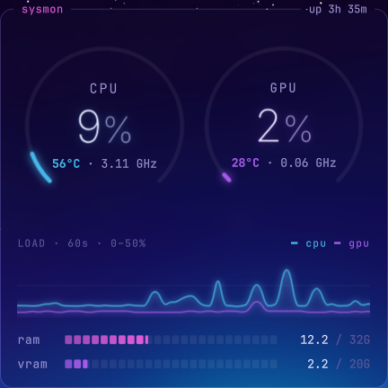
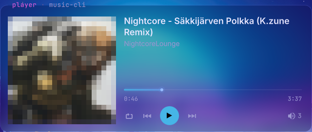
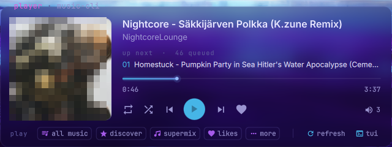

# Neon Glass widgets

Two KDE Plasma 6 widgets with a dark glass look and thin neon accents. They pair with the [NeonGlass icon theme](https://github.com/3L0935/neon-glass-icons). Every color, the fonts and the glass are configurable from the widget settings, no code to edit.

| Neon Glass Monitor | Neon Glass Player |
|---|---|
|  |  |

- **Neon Glass Monitor**: CPU and GPU usage rings (temperature and clock speed), a smooth load-history graph, RAM and VRAM bars.
- **Neon Glass Player**: a now-playing card for any MPRIS player: music apps, browsers, Spotify, Tauon, mpv… The taskbar version shows the cover, the title, a thin progress line and the transport buttons, and opens the card on click.

## Install

Needs Plasma 6.

```sh
git clone https://github.com/3L0935/neon-glass-widgets
cd neon-glass-widgets
./install.sh            # both widgets; or: ./install.sh player
```

Then right click on the desktop or a panel → **Add Widgets…** → search "Neon Glass".

To update: `git pull && ./install.sh`, then restart Plasma (`systemctl --user restart plasma-plasmashell`).

## Settings

Right click a widget → **Configure…**

**Appearance** (same page on both widgets)
- **Colors**: accent, secondary and third accents, and three text shades. There's a button to go back to the default palette.
- **Glass**: tint, opacity, border color and opacity, corner radius.
- **Fonts**: text font and numbers font. They default to Inter and JetBrains Mono when installed, else to your system fonts.
- **Blur behind**: KWin can't blur what is under a desktop widget. Pick the same image as your wallpaper (in "Scaled and cropped" mode) and the widget blurs it under itself, lined up with the real wallpaper. Leave it empty for plain translucent glass, and raise the glass opacity a bit.

**Monitor**
- Title, host name and uptime in the header.
- Which sections to show: GPU ring, load graph, RAM, VRAM.
- Which GPU to read (`gpu0`, `gpu1`… same numbering as System Monitor) and the graph length.

**Player**
- Title, and the player switcher shown when several players run (`auto` follows the one that's playing).
- **Icons**: automatic (Nerd Font glyphs if a Nerd Font is installed, else your icon theme), Nerd Font only, or icon theme only.
- **Volume**: mouse wheel step, and a fine step for Shift + wheel.

## Player tips

- Click the progress line to seek. Use the mouse wheel on the volume number.
- In the taskbar: click to open the card, middle click to play/pause, wheel for volume.
- The loop button cycles through off, playlist and track.

## Optional: music-cli integration

[music-cli](https://github.com/Igidn/music-cli) is a YouTube Music player for the terminal. With the extras installed, the player gets more features when music-cli is playing:



- **Playlist shortcuts**: all music, discover, supermix, likes, and **more** to browse every playlist in your library.
- **Like** the current track, and **reshuffle** the up-next queue without stopping the song.
- **Up next**: the next tracks of the queue.
- **Loading feedback** while music-cli downloads the next track.
- **refresh** runs `neonglass-mix`, **tui** opens music-cli in a terminal, and **quit** closes the TUI and stops music-cli.
- When nothing is playing, **▶** starts music-cli (it resumes the last track, or plays All Music on a fresh install) and the playlist shortcuts stay available.

music-cli has no MPRIS support on Linux, so the extras add it. Your media keys and KDE's media controls then work with music-cli too.

### Install the extras

```sh
extras/music-cli/install.sh
```

It installs:
- a small hook into music-cli's own Python environment. It patches music-cli as it loads and doesn't modify music-cli's files. It adds MPRIS, the reshuffle command and a "neon-glass" TUI theme (Ctrl+P → Theme).
- the `neonglass-player` command (used by the widget) and the `neonglass-mix` command, in `~/.local/bin`.
- a starter config, `~/.config/neonglass/mix.json`.

Then quit music-cli once (Ctrl+Q in the TUI) so its daemon picks up the hook. Finally, in the player settings → General, tick **Enable music-cli integration**.

Upgrading music-cli wipes the hook: run `extras/music-cli/install.sh` again.

### neonglass-mix

`neonglass-mix` keeps your YouTube Music library tidy and full of new music:

1. **Genre playlists**: it sorts your liked songs into one playlist per genre, using the artists and the keywords you set.
2. **Radar playlists**: one per genre, plus extra "corners" you list. Each is filled with YouTube's own mixes and radio from your likes, minus the songs you already like or played recently.
3. **All Music**: all your likes plus a slice of every Radar and your Supermix, shuffled again on every run.
4. **Cleanup**: it removes the noisy YouTube mixes from your library ("My Mix 1…6", Replay, Archive) and keeps Discover, New Release and Supermix.

It updates the playlists in place, so they keep the same id and link and never pile up. To set it up:

```sh
$EDITOR ~/.config/neonglass/mix.json   # your genres and keywords
neonglass-mix --dry-run -v             # see what it would do
neonglass-mix
```

To run it every week, add a systemd user timer, or press **refresh** on the card.

## Development

`shared/` holds the files both widgets use: the palette, the glass card and the Appearance settings page. After editing them, or a package's `config/general.xml`, run:

```sh
tools/sync-shared.sh && ./install.sh
```

## License

MIT, see [LICENSE](LICENSE).
